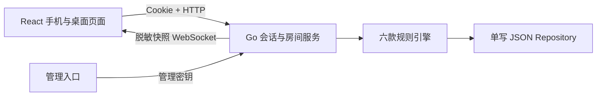

# 架构与数据流

2026-10-24，六款游戏开发验收版。

浏览器 React/TypeScript 页面通过同源 HTTP 创建账号、房间和提交操作，通过 WebSocket 接收自己可见的牌桌快照。Go 服务端是规则和结算的唯一权威，客户端只显示服务端给出的合法操作。正式牌桌的洗牌使用系统密码学随机源。

`backend/internal/game` 管理对局状态、合法操作、摸打响应与零和记分。共享动作流程调用各玩法策略，不将规则视作同一款游戏换名字：`rules/hongzhong`、`nohongzhong`、`sichuan` 分别决定人数、花色、手牌结构、声明与基础番表；`rules/hongershi`、`doushisi` 分别决定牌组、配对、红点、奖励和支付公式；`runfast` 负责独立出牌规则。`rules/mahjong`、`rules/capture` 只提供相应策略的数据契约和共用算法。规则差异回归位于 `rules/variants_test.go`。

房间服务处理座位、准备、补电脑、下一局、解散投票、权限、重连与定时托管。`management.go` 处理茶馆申请、审核、成员角色/禁玩、固定玩法和统计；服务端从启用模板生成配置，忽略客户端篡改。`TeaHouse.tsx` 提供茶馆大厅、玩法、成员、审核、战绩、设置；普通成员看不到管理操作。

每次 tick 对启用自动开房的茶馆逐模板检查是否有完全空的等待桌，先持久化成功再公开新桌。首位入座者获得房主身份。管理员可关闭馆内房间，持久化失败回滚，保留已完成局及记分账，未完成局不计分。账户/茶馆和房间重启后分别加载，已存在的空桌不会重复补建；目前馆内列表通过刷新按钮读取，不是实时推送。

客户端提交房间版本及请求 ID；过期版本返回409和最新快照，重复请求受保存的请求记录约束。当前还没有独立协议版本协商和全局动作序列协议。WebSocket 仅允许房内账号，并验证同源；其他人的暗手和牌墙不会进入该玩家快照。管理员接口也不返回暗手。

存储保存账号、恢复凭据摘要、会话摘要、亲友圈与房间。写入采用临时文件、同步、重命名；写失败回滚内存并返回503。服务重启后可读取房间继续。当前一个全局互斥锁串行保护状态，必须单进程、单数据目录写入，未接入 PostgreSQL 或 Redis。多文档没有事务、数据目录没有进程锁，也不承诺断电级目录同步。

定时器每300ms检查状态；普通操作30秒、响应10秒，电脑或离线玩家短延迟执行保守合法动作。电脑以练习和保持流程运转为目标，没有胜率优化；不主动选择碰杠、报胡等需要额外决策的可选动作。玩家可手动操作这些规则。

HTTP 提供 `/healthz`、`/readyz`、`/metrics`；指标与后台依赖管理密钥。主要业务接口位于 `/api/`，实时通道 `/ws`。健康检查只确认程序与已加载状态，不代表磁盘持续可写。

静态资源、图标、牌面和提示音为本项目制作。未连接原私有服务，未拷贝原游戏执行代码或美术音效。完整规则仍以六款审阅 TXT 的“本稿采用”及客户后续修订为准。
